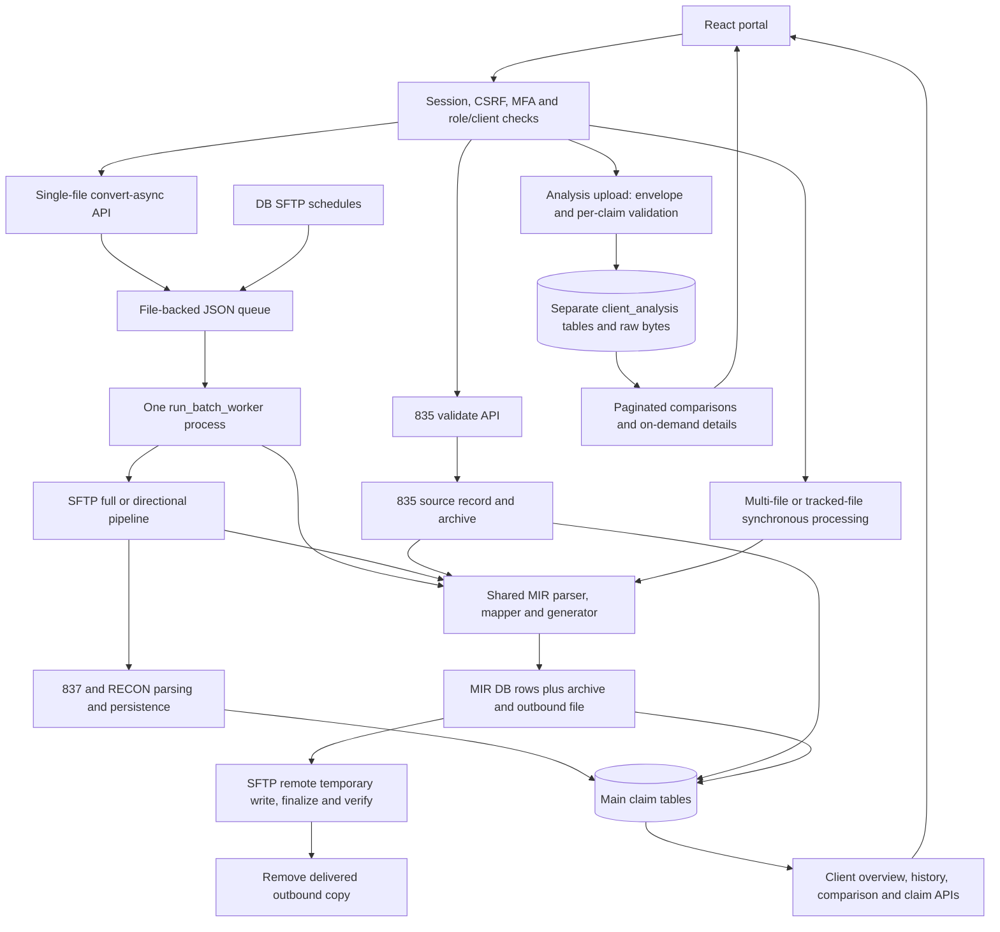
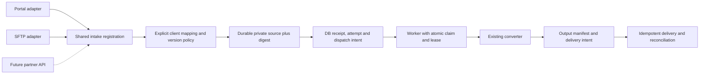

# Phase 1: system inventory and delivery gates

Reviewed 21 October 2026. Baseline before this change: backend `7c2d2ca`, frontend
`53b24ed`. This inventory describes repository behavior, not an attestation of the
AWS configuration. Sources below are executable modules and URL registrations;
older duplicate view functions are not assumed to be active.

Follow-up package: [decisions, operating policy, migration plan and acceptance
guide](phase1_readiness.md). It adds a singleton worker guard, queue observation,
synthetic converter demonstration and reproducible local verification. Formal
owner approvals and AWS/partner evidence remain pending.

## Result against the three requested items

| Requirement | Repository deliverable | Remaining production evidence |
|---|---|---|
| Inventory all existing flows | Documented below, including active routes, stores, failures and diagrams | Operator must verify deployed units, routes, schedules and backup jobs against this map |
| Confirm versions, conventions and routing | [Compatibility matrix and fixture inventory](phase1_compatibility.md); cross-client folder-observer bug fixed | Partner acceptance, real client-to-sender mappings and guide coverage remain unapproved |
| Measure volume, timing and capacity | Read-only `phase1_baseline` command, regression tests and [measurement/restore runbook](phase1_operations.md) | Run on AWS and conduct an isolated load/restore exercise; no production numbers are invented |

Code evidence, local tests, production observation and partner approval are separate
gates. These changes complete the repository discovery package; they do not justify
changing all three specification rows to “Implemented and production verified”.

## Current flow map

Analysis does not feed the live conversion/SFTP pipeline. Database source copies
and local archive copies are operational storage, not an independent backup.

## Entry points and responsibilities

API paths are backend paths; frontend deployment may proxy these to the backend.

| Flow | Active entry and implementation | Persistence / output | Failure and retry boundary |
|---|---|---|---|
| Portal authentication | `accounts/urls.py`, `accounts/views.py`, `project835/middleware.py`, `drf_compat.py` | Django session; user/client association; MFA state | Session, CSRF and role checks precede protected operations; deployment origins/cookies must agree |
| Manual 835 validation | `/api/validate/`, `converter/validation_views.py`, `_validate_835_for_conversion` | Single source archived and represented by `EDI835File`; validation findings returned | Single and multi-file branches differ; multi-file validation does not create one receipt per file |
| Single 835 conversion | `/api/convert-async/`, `converter/async_conversion.py`; frontend `src/utils/requestGovernor.js` rewrites eligible `/api/convert/` JSON requests | JSON job + source status, then MIR/source records | Queue file and DB status are not one atomic transaction; eligible existing active jobs can be reused |
| Synchronous conversion | `/api/convert/`, `converter/conversion_views.py`; `/edi835/api/process/`, `edi835/views.py` | Shared `services.process_edi835_file_content` / `process_multiple_edi835_files` | HTTP lifetime applies; multi-file conversion combines accepted sources into one MIR, not one output per file |
| Client claim conversion/action | `/edi835/api/client-portal/convert/`, `client_portal_conversion.py`; actions/review routes | Main claim/action records and conversion output | Role and tenant checks remain required even where the Conversions page is hidden |
| Full SFTP run | `/api/start-batch-conversion/` and `/edi835/api/start-batch-conversion/`, `batch_test_837_v3.py`, `full_sftp_pipeline.py` | Ordered 837 relay, RECON ingestion, combined 835 conversion/delivery | Partial stage failures collected; accepted 835 remote sources removed only after confirmed MIR delivery |
| Scheduled SFTP | `/edi835/api/admin/sftp-automation/`, `sftp_automation.py`, `sftp_automation_operations.py` | Schedule/run DB rows, JSON dispatch, directional/full processing | Bounded scheduled retries; DB schedule locking does not make filesystem dispatch atomic |
| Directional 835 incoming | `sftp_automation_operations.py` | Archived local source + DB `UPLOADED` or `ERROR` | Archived invalid input may be removed from remote; unlike full-pipeline handling, retention is local |
| Main 837 upload/relay | `/edi835/api/837/upload-process/`, `edi837_views.py`, `edi837_service.py`; SFTP transfer/search routes | `EDI837File`, claims and service lines; archive/outbound | Same-content arrivals are deliberately separate main-portal records; Analysis deduplication does not apply here |
| RECON intake | `/edi835/api/recon/upload/`, process/detail routes, `recon_service.py`; full SFTP stage | `RECONFile`, claims, services, findings | Validation and hash-reuse vary by entry path; legacy 837 references can also live in `RECONFile` |
| Local folder observer | `services.sync_folder_observer`, explicit full-sync listing path | Discovers 835 input files and updates archive presence | On-demand scan, not a standalone watcher. This change scopes filename existence to the same client, including the unassigned/system scope |
| Analysis upload | `/edi835/api/client-portal/analysis/`, `client_portal_analysis.py` | `AnalysisUpload`, comparison rows, normalized 835/837 claims, services, rejected claims, identity fingerprints | Envelope failure rejects file; claim errors can partially save; tenant lock and uniqueness protect duplicate detection; whole duplicates return 409 |
| Analysis reads | Same endpoint read modes, `analysis_read_api.py`, `analysis_queries.py` | PostgreSQL grouping/filtering/pagination; separate claim/rejection details | Does not re-download all saved sources for each page; no live-table merge |
| Client read/export | Overview/history, comparisons, claim/source/download routes in `edi835/urls.py` | Existing main tables; CSV and claim slices | Tenant scope and masking enforced by their respective API/UI paths |
| Generated output and download | `mir_persistence.py`, `storage.py`, converter download routes | Exact MIR DB content + normalized rows + client archive/out copies | Local output removed after delivery; MIR for a source can be replaced on regeneration, not an immutable attempt ledger |
| Archive download/offboarding | Root `/api/download-zip/`, `converter/offboarding_archive.py`; separate legacy `/edi835/api/download-zip/` | Operational export of supported source/output records | Not a full restore package: Analysis, queue, all configuration, keys and audit data are not included |
| Held claims and alerts | `held_claims.py`, `missing_reference_alerts.py`, `long_hold_alerts.py`, worker command | Release/action/history records; email via admin email service | Scheduled in the batch worker; worker availability affects these duties too |
| Optional MPL analysis | `mpl_views.py`, `run_mpl_notice_worker`, deployment unit templates | Notice/analysis/workflow tables, source and model results | Separate worker; deployment and model service availability not verified |

## Worker, storage and infrastructure boundaries

| Component | Evidence | Operational implication |
|---|---|---|
| Web backend | `mir.service` named by operator; repo worker drop-in in `deploy/mir-workers.conf` | Actual base unit, bind/socket and effective Gunicorn arguments must be inspected on AWS |
| Batch worker | `deploy/mir-batch-worker.service`, `management/commands/run_batch_worker.py` | Separate process, two-second queue polling; template memory limits are 1 GiB high / 1200 MiB maximum, not a measured capacity result |
| Job persistence | `batch_jobs.py`, `MEDIA_ROOT/edi835/batch_jobs/*.json` | Atomic file replacement; updated worker acquires an exclusive OS lock before recovery/processing. One cooperating worker per local queue directory; no multi-host lease or atomic DB dispatch |
| Crash recovery | `recover_interrupted_jobs` | Running jobs become failed on startup; this is not automatic exactly-once resume. Finished job files expire after seven days |
| Core conversion | `converter/services/parser.py` -> `admin_panel/mir_mapper_logic/converter.py`, parser, mapper, generator | Shared conversion implementation exists; intake validation and dispatch are still separate |
| Database | `localsettings.py`, models/migrations | PostgreSQL production; SQLite only behind explicit test guard. Source content stored alongside structured columns |
| Client filesystem | `storage.client_storage_dirs` | `MEDIA_ROOT/<client UUID>/files/{835,837,mir,recon}/{in,archive,out}` as applicable; client documents separate; unassigned scope uses `system` |
| Analysis storage | `client_analysis_*` tables | Raw binary source and relational claims in DB, no main-portal filesystem output |
| Credential storage | `project835/field_crypto.py`, SFTP/SMTP configuration | Encrypted stored secrets depend on separately recoverable encryption keys; never put keys in this report |
| Audit | Admin audit model/migration trigger and audit call sites | Hash-linked records exist; not evidence of complete coverage of every read, transfer and failure |
| Health | `project835/views.py` | Database connectivity + migration state only; a green response does not prove worker, SFTP, disk or backups are healthy |
| Frontend boundary | Frontend `src/main.jsx`, `src/App.jsx`, `vercel.json`, `src/utils/csrfFetch.js`, request governor | React route persistence and API/session handling; proxy origin and CSRF settings must agree |
| Backup / restore | No complete scheduled backup and restore procedure established from this repository | AWS backup existence is unknown, not presumed absent. Verify DB + files + queue + configuration/key recovery together |

## Routing and authorization

Client-user and Demo requests derive their scope from the assigned user/client;
Demo is restricted to Analysis and its permitted operations. Admin access uses
admin role/grant checks and the selected client; super-admin access is broader.
Changing a Demo user's client changes the permitted Analysis scope, not data ownership.

`admin_sftp_routes.resolve_admin_sftp_route` resolves the selected client's
dedicated/default/transitional configuration first, then a global configuration.
The selected row must be connected and contain credentials plus the exact-purpose
folder: `837_IN`, `837_OUT`, `835_IN`, `MIR_OUT`, or `RECON_IN`. An unrelated folder
is not substituted. This is configuration-based client routing; the reviewed paths
do not establish an approved sender/receiver-to-client identity matrix or guarantee
that a file contains only that client's claims.

The observer defect fixed here concerned filename collisions between clients,
not a new cross-client access permission. It now checks `(client, filename)`.
Concurrent scans within one client still need separate serialization if multiple
observers are introduced; this patch does not claim to solve that different race.

## Proposed design and staged migration

This is a proposed Phase 2 design, not functionality shipped by this change.
Retain Django/PostgreSQL and the existing converter. Select a durable DB dispatch
mechanism before choosing a new worker framework; Celery/Redis are not required
just to finish Phase 1. Keep Analysis isolated unless a separately reviewed merge
is requested. Introduce new receipt/attempt/outbox records additively, migrate one
adapter behind a flag, reconcile outputs, then retire duplicate dispatch paths.
Do not run old and new dispatchers against the same source simultaneously.

## Prioritized decisions and backlog

Owners below are accountable roles to assign to named team members; they are not
an assertion that someone has already approved a decision.

| Priority | Work / decision | Owner | Acceptance evidence / affected rollout |
|---|---|---|---|
| Fixed | Tenant-scoped observer filename check | Backend | Regression: same name in two clients and system scope is independently discovered; repeated scans add no new row |
| Done locally | Baseline command, inventory, corrected 835 fixture guide | Backend / technical lead | Focused tests plus report artifacts; production gate remains below |
| P1 | Verify deployed routes, credentials, pinned server trust and explicit sender/client mapping | Infrastructure + integration lead | Per-client matrix with no secrets; reject/hold ambiguous mappings before onboarding affected partners |
| P1 | Atomic durable dispatch and distributed lease design | Backend | Local singleton enforcement is now implemented; DB/queue crash boundaries and uncertain-delivery reconciliation remain Phase 2 work |
| P1 | Unify validation and duplicate/retry contracts by intake route | Backend + QA | Same fixtures across manual, SFTP and Analysis with explicitly documented intentional differences |
| P1 | Measure production baselines and isolated representative load | Infrastructure + QA | Volume, size, queue-age, latency percentiles, memory and error evidence; numeric acceptance thresholds agreed |
| P1 | Backup consistency, restore exercise and key recovery | Infrastructure + security | Isolated restore evidence, measured RPO/RTO and approved retention; gates recovery claims |
| P2 | File-ready protocol and delivery acknowledgement/reconciliation | Integration lead | No partial-file ingestion; replay after remote-send/local-delete failure produces defined result |
| P2 | Upload/retention/queue-age limits and capacity targets | Product + infrastructure | Numeric policy tied to measured workload, not arbitrary defaults |
| P2 | Complete operation audit and health coverage | Backend + infrastructure | Correlation from intake through output; worker/disk/SFTP alerts; no PHI in telemetry |

Sequence: finish AWS/partner evidence and agree decision owners and targets. The
[delivery plan](phase1_delivery_plan.md) now provides a scoped planning range and
dependencies; revise it using observed workloads and team availability. It is not
a production date commitment.

## Verification for this change

`edi835.test_phase1_baseline` covers scope/window boundaries, negative and missing
durations, aggregate byte counts, empty data, invalid options, read-only queries,
absence of source payload queries by default and same-name client isolation.
The Analysis, listing and storage regression suites also run after the fixture fix.

Initial local verification on 21 October 2026 (before the follow-up readiness package):

- Focused baseline, observer, Analysis, listing and storage suites: **57 passed**.
- Broader release regression suite: **205 passed, 1 skipped** (206 discovered).
  The skip requires PostgreSQL for an exact numeric precision test.
- Across these overlapping suites: **212 distinct tests passed, 1 skipped**.
- Django system checks reported no issues. No schema migration is introduced.
- Frontend unchanged; no browser interaction or AWS deployment was performed for
  this backend/documentation change.

PostgreSQL read-only snapshot/timeout behavior, deployed routing, load limits and
restoration still require the runbook checks. SQLite test results do not establish
PostgreSQL locking, production performance or partner approval.
