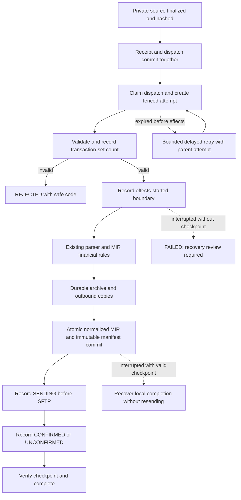

# Phase 2: execution recovery and durable output checkpoints

Implemented against backend `933ead4c9235d8edde5a05b7fad67418e20e338f`.
This supersedes the recovery limitations in `phase2_shared_intake.md`.
It is implementation evidence, not production acceptance or retention approval.

## Findings and changes

| Gap | Implementation | Boundary |
|---|---|---|
| Retry and reconcile | Database polling, bounded safe retries, expired-lease recovery, stranded-intent repair, integrity inspection and reversible orphan/temporary quarantine. | Uncertain effects are not automatically replayed. Quarantine requires stopped producers. |
| Shared lifecycle | Receipts use RECEIVED, VALIDATING, QUEUED, PROCESSING, COMPLETED, REJECTED, FAILED and DUPLICATE. | Legacy polling responses and workflow-table status vocabularies remain compatible. |
| Common outcomes | Validation outcome, safe error code, observed transaction-set count, converter code fingerprint, source reference and output references. | Counting ST segments is not validation. Unknown counts remain null. Code version does not imply approval of dynamic client mappings. |
| Processing attempts | Unique sequences, parent attempts, owner tokens, renewable expiry, heartbeats, retry reasons and converter versions. Database constraint allows one RUNNING attempt per dispatch. | PostgreSQL row locks are required in production; the existing single-worker host lock remains. |
| Durable MIR completion | Flushed archive/out copies; private immutable output; normalized MIR rows and manifest committed together before delivery; verification before completion. | Remote SFTP acknowledgement remains separate from local conversion completion. |

## Flow



`INTAKE_LEASE_SECONDS` defaults to 300 seconds, with renewal every one third of
the lease. `INTAKE_MAX_ATTEMPTS` defaults to three total attempts. Expired owners
cannot renew or finish a job. Delayed jobs cannot be claimed early, including
from stale queue snapshots. Recovery runs at startup and periodically.

Effects are recorded before entering the existing processor. If execution then
disappears without a durable MIR checkpoint, the job requires review. Configured
scheduled retry counts no longer override this boundary. Transient dependency
failures before effects can retry; authorization and validation failures do not
enter unlimited retries. This favors avoiding duplicate deliveries over blindly
retrying every failure.

Portal, Analysis, main 837, tracked conversion and direct SFTP receipt adapters
record attempts. Inline adapters renew their own leases, including nested SFTP
work. Production uses autocommit outside short explicit transactions. Do not
enable request-wide `ATOMIC_REQUESTS` around these adapters without redesigning
the commit boundary: a separate heartbeat cannot see uncommitted attempt rows.
Leases detect lost execution; they are not a maximum CPU/runtime budget.

## Output identity and replay

- Combined batches still produce one combined MIR; financial mappings are unchanged.
- New conversion source identity derives from the dispatch. Each dispatch/source
  has one immutable output manifest.
- Identical normalized persistence returns the existing row and delivery status.
  Different content cannot overwrite a checkpointed MIR.
- Replay returns a committed output without calling the generator or SFTP again.
  An explicit new conversion of an already checkpointed file preserves the old
  normalized rows in a separate version and retains its original processing date.
- Recovery may complete local conversion once its output verifies. NOT_STARTED,
  SENDING and UNCONFIRMED delivery states remain visible; no remote receipt or
  resend is inferred.
- Rejected batch members retain their own outcomes even if siblings succeed.
  A filename alone does not identify an input. Analysis duplicates have a typed code.

The private output copy costs additional storage and hashing I/O, but permits
recovery independently of mutable legacy archive/out directories. Queue pruning
preserves attempt history and referenced receipts/outputs. Approved permanent
client deletion includes the new private objects.

## Reconciliation

Use the service database/private-storage configuration:

```bash
# Read only; hashes require reading originals.
python manage.py intake_reconcile --verify-hashes --scan-media-temporaries

# Safe lifecycle/intent repair; no quarantine or external sends.
python manage.py intake_reconcile --apply --verify-hashes
```

Receipt scans use `--limit` (default 1000). Continue with the returned
`next_after_receipt` using `--after-receipt`. Output verification is a full scan
with chunked DB iteration; schedule it away from peak ingestion for large histories.
Sources missing during a live lease are reported without forcibly stopping it.

Private `.bin`/`.part` candidates must be unreferenced by receipts and manifests
and older than `--grace-hours` (default 24). Optional media scanning recognizes
only the atomic writer's UUID `.tmp` pattern. Final legacy archives/outbound files
are not removed; symlink candidates are ignored.

After draining/reviewing queued work and stopping **all** web, API, SFTP and worker
producers, an operator can quarantine candidates:

```bash
python manage.py intake_reconcile --apply --quarantine-orphans \
  --producers-stopped --scan-media-temporaries --grace-hours 24
```

`--producers-stopped` is an operator assertion, not proof that external producers
are offline. Active dispatches also block quarantine. Copy/fsync/hash verification
precedes removing the original, including across volumes. A crash can retain two
copies rather than lose data. Nothing is permanently deleted.

Restore under maintenance from `.quarantine/<id>/object`, using its private
`manifest.json` original location. Verify the destination and never overwrite a
different file. Retention and permanent deletion still need owner policy.

## Upgrade

Migrations **0060** and **0061** are additive. Existing receipt states are mapped
from dispatch status; historical validation is explicitly `NOT_RECORDED`.
Old attempts, converter versions and output checkpoints are not fabricated.

Back up the database and private/media storage. Drain active conversions and stop
all producers before deploying; do not mix old/new workers. On the existing host:

```bash
cd /var/www/835_to_MIR_backend
sudo systemctl stop mir.service mir-batch-worker.service
git pull --ff-only origin main
source venv/bin/activate
python manage.py migrate --noinput
python manage.py check
python manage.py intake_migrate_jobs
python manage.py intake_reconcile --verify-hashes
sudo systemctl restart mir.service mir-batch-worker.service
sudo systemctl status mir.service mir-batch-worker.service --no-pager
```

Proceed only when each step succeeds. If verification fails, investigate while
services remain stopped. These commands were **not executed on AWS** in this task.
No new dependency installation is needed. Keep private storage durable and backed
up with PostgreSQL. Do not roll back by dropping tables or replaying old JSON jobs.

## Verification

`phase2_recovery_verification.json` records the isolated regression run covering
intake, authentication, tenant isolation, Analysis, financial rules and combined
SFTP behavior. New fault tests cover:

- Attempt uniqueness, renewal/expiry, stale writers, parent attempts, bounded
  retries, delayed claims and no automatic replay after effects.
- Durable recovery without resend, damaged/missing output, immutable conflicts,
  rollback when checkpointing fails, replay and explicit new conversion versions.
- Dry-run/repair, missing sources, stranded intents, reversible quarantine,
  media temporary cleanup, final-file preservation and per-source rejection.
- Safe API metadata, duplicate lifecycle, fresh migrations and upgrades that
  preserve old tenant/file data and backfill lifecycle repeatably.

The local suite uses SQLite: **309 tests, 307 passed, two PostgreSQL-only checks
skipped**. The JSON records the tested source fingerprint. Skips are the existing PostgreSQL numeric precision check and the new
concurrent claim test. Run concurrency on an **isolated PostgreSQL test database**
with its own `DATABASE_URL`, never production:

```bash
python manage.py test edi835.test_intake_postgres --settings=project835.test_settings
```

Staging must additionally verify Linux filesystem durability, separate-connection
lease renewal, worker termination around commit/SFTP acknowledgement, permissions
and restoration. Five earlier legacy test failures, reproduced before this work,
remain documented in `phase2_shared_intake.md`; they are not counted as passes.

This does not claim exactly-once external delivery or automatic replay of every
historical auxiliary workflow. Standalone held-claim release and legacy RECON
subprocess processing keep their orchestration; reconciliation does not replay
them. Old artifacts without manifests require review. Partner acknowledgement,
retention/RPO/RTO approval and production capacity remain operational release work.
