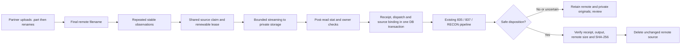

# Phase 2 SFTP readiness, ownership and trust

## Result and scope

This change follows backend commit `30d40bd` (intake recovery/output checkpoints).
It adds migration `0062_sftp_source_claims` and changes backend ingestion only.
Financial conversion rules, Analysis uploads, and frontend APIs are unchanged.
An existing administrator client-selection bug found by the expanded tests is
also corrected: an explicit authorized client takes precedence over an admin's
own client assignment. Non-staff users cannot select another client.

| Gap | Implemented behavior | Remaining operational requirement |
|---|---|---|
| Complete uploads | Persistent size/mtime observations separated by at least `SFTP_STABILITY_SECONDS` (default 30); temporary names and symlinks excluded; size/mtime checked again after streaming and before acceptance. | Partners must close uploads and atomically rename `.part` to a unique immutable final name. Stability alone cannot detect a writer paused longer than the observation interval. |
| Safe source retention | Receipt and verified private original required before deletion; failed/rejected files retained; combined 835 additionally requires a confirmed MIR checkpoint with verified local output. | SFTP acknowledgement is not proof of the partner filesystem's power-loss durability or downstream consumption. Verify the partner's durability/acknowledgement contract. |
| Concurrent pollers | PostgreSQL row-locked source claim shared by manual, scheduled and compatibility adapters. Renewable owner lease survives connection reconnects within a run. | Run the PostgreSQL concurrency tests on staging. All workers must use this version and the same DB. |
| Host identity | All application SSH helpers use known hosts and RejectPolicy. Legacy `trust_unknown_key` fields cannot bypass checking. | Install verified host keys for each service identity before restart. Provision and test inbound accounts on the actual SSH server. |

## Data flow and adapter coverage



Covered: full 835/MIR pipeline, full RECON pipeline, directional 835 intake,
837 relay/search transfer, selected-file 837 ingestion, legacy batch conversion
and its cleanup reconnect. Old relay entry points delegate to the guarded relay.
Outbound connections and directory browsing do not acquire intake claims.
Every connection, including browse/test/output, verifies the server key.

Source identity hashes normalized host, port, username and server-canonical path;
it excludes the adapter/workflow, so two routes using the same account/path
contend for one claim. A path already assigned to another client is refused.
Different usernames, DNS aliases or chroot namespaces cannot reliably be resolved
to the same physical source by SFTP; configure one canonical intake account and
endpoint per folder. Partners must not overwrite final names. The stat/hash/unlink
sequence fences application pollers but cannot lock an external remote writer.

`OBSERVING` waits for stability; `READING` owns the download; `STORED` has durable
private bytes and may have a bound receipt; `REMOVED` records successful cleanup.
`ACCEPTED` retains validated 835s for the staged conversion workflow. `REVIEW`
retains uncertain or rejected work. A later changed size/mtime can start a fresh
observation only after the previous session has released ownership; a crashed
stored source is never automatically taken over. Unique final names are required
when replacing bytes with identical size and mtime.

A worker that dies before durable storage can be replaced after lease expiry.
A worker that dies after storage/acceptance requires review; automatic replay
could duplicate a partner delivery. This intentionally favors avoiding duplicate
deliveries over unattended recovery. A failed inbound deletion no longer deletes
an already delivered 837 from outbound. Validation-only 835 intake no longer
deletes either invalid files or valid files awaiting conversion/delivery; retained
validated sources require later operator-approved cleanup under the retention
policy. They are not repeatedly ingested on each poll.

Private objects referenced by source claims are protected from orphan quarantine.
Authorized permanent client deletion checks active source leases and includes
these objects. Routine status reporting never includes filenames or claim data.

## Configuration and rollout

```dotenv
SFTP_KNOWN_HOSTS_FILE=/etc/mir/ssh_known_hosts
SFTP_STABILITY_SECONDS=30
SFTP_SOURCE_LEASE_SECONDS=300
```

The stability interval is time between observations, not time since the remote
mtime. A newly observed file waits until a subsequent poll. A daily schedule can
therefore defer it until the next scheduled run; poll more often or rerun after
the interval. No request sleeps to wait for an upload. No settings disable host
key verification. Unknown hosts and changed keys fail closed even if an old
connection record says `trust_unknown_key=True`.

Obtain the server host public key/fingerprint from its administrator over a
trusted independent channel. For nonstandard ports use `[hostname]:port` in
known_hosts. `ssh-keyscan` may collect a candidate key, but its output is not
trusted until its fingerprint matches that independently supplied value. Install
the verified file root-owned, readable by the users running both MIR services;
do not allow the application to modify it. Validate key rotation before replacing
a pin. Paramiko also loads the service user's existing known_hosts.

After backing up PostgreSQL and draining running jobs, use the deployment's
normal environment loader. Stop both processes to avoid mixed-version pollers:

```bash
cd /var/www/835_to_MIR_backend
source venv/bin/activate
sudo systemctl stop mir.service mir-batch-worker.service
git pull --ff-only origin main
python manage.py migrate --noinput
python manage.py check
sudo systemctl restart mir.service mir-batch-worker.service
sudo systemctl status mir.service mir-batch-worker.service --no-pager
python manage.py sftp_source_status
```

Only restart after migrations/checks succeed and trusted host keys are installed.
Do not run concurrent old workers or roll back to code that ignores source claims
while work is active. No frontend deployment is required for this change.

## Restricted inbound accounts: infrastructure template

`deploy/60-mir-partner-sftp.conf.example` applies only to a new dedicated
`mir-sftp-partners` group on the inbound SSH server. It enforces key-only SFTP,
tenant-specific chroots, no shell/PTY/tunnel/forwarding and a private creation
umask. Do not add existing operator accounts to this group.

For each approved partner, an infrastructure administrator must:

1. Create a dedicated Unix account with `/usr/sbin/nologin`, membership in
   `mir-sftp-partners`, no usable password, and home `/inbound` inside its jail.
2. Create `/srv/mir-sftp/USERNAME`, owned by root, mode `0755`; every parent must
   also be root-owned and not writable by the partner. Create its `inbound`
   directory owned by that partner, mode `0700`. Never use another client's jail.
3. Install the approved partner public key in root-owned
   `/etc/ssh/authorized_keys/USERNAME`, mode `0600`; protect the parent directory.
   Plan separate consumer credentials/ACLs if the portal does not use this
   account. A tenant must never read another tenant's files.
4. Restrict port 22/network ingress to approved partner addresses in the security
   group/firewall. Install the example under `sshd_config.d` only if included by
   the server's existing configuration. Inspect effective configuration before
   changing any running SSH service.
5. Keep the existing administrative SSH session open and run:

```bash
sudo sshd -t
sudo sshd -T -C user=PARTNER_USERNAME,host=PARTNER_HOST,addr=PARTNER_IP
```

Confirm `forcecommand`, `chrootdirectory`, key authentication, disabled forwarding
and PTY in the effective result. Then reload the server's SSH service using its
normal change process. Test with the approved key: SFTP upload/rename works;
password auth, shell execution, TCP forwarding and access outside the jail fail.
The group/template is not a claim that production accounts have been provisioned.

## Verification and recovery operations

Local verification: **360 tests run, 357 passed, 3 PostgreSQL-only skips**, with
no failures. Fresh SQLite migration, upgrade/repeat through 0062, and migration
drift checks passed. Tests ran from an isolated Git-tree snapshot so concurrent
Analysis work in the shared checkout was not included. Evidence and snapshot
identity: `phase2_sftp_verification.json`.
It covers first/second observations, growing files, temporary names/symlinks,
mid-download changes, cross-client isolation, stale owners, successful real 837
ingestion, missing receipts, failed processing, validation-only retention, MIR
delivery gating, same-size replacements, legacy reconnects and host-key rejection.
Older stale test mocks were updated to target the current sequential converter
and current queued full-pipeline route. Converter business behavior is unchanged.

Before production acceptance, use an isolated PostgreSQL staging database:

```bash
python manage.py test edi835.test_intake_postgres --settings=project835.test_settings
python manage.py sftp_source_status --limit 100
python manage.py intake_reconcile --verify-hashes
```

Also simulate two pollers on the same partner folder, a growing `.part`, a final
rename, a killed downloader, a killed post-acceptance worker, outbound failure,
source replacement, and an unknown/changed host key. Confirm exactly one receipt
per claimed generation and retained sources on uncertain outcomes.

For REVIEW/STORED-expired entries, inspect the receipt/attempt/output IDs using
the existing intake audit tools and confirm partner delivery before any replay.
Do not bulk clear claims or resend uncertain outputs. Correct rejected source
data and publish under a new immutable name. Retain accepted source files until
the configured retention and delivery policy permits cleanup.

Production PostgreSQL concurrency, live SSH trust, chroot enforcement and remote
durability require environment verification; this local Windows run cannot
establish them. No AWS service or partner account is changed by this commit.

References: [Paramiko SSH client](https://docs.paramiko.org/en/stable/api/client.html),
[OpenSSH sshd_config](https://man.openbsd.org/sshd_config), and
[OpenSSH sftp-server](https://man.openbsd.org/sftp-server).
