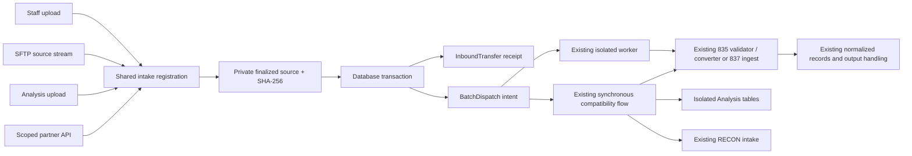

# Phase 2 — shared intake implementation and rollout

The follow-up [execution recovery implementation](phase2_recovery.md) adds
leases, processing attempts, reconciliation and durable output checkpoints.

This change closes the database/queue handoff gap for the existing batch worker
and introduces a shared source-registration boundary. It does not change MIR
financial rules, claim mapping, Analysis comparison rules, or tenant access.
Production rollout and PostgreSQL concurrency verification remain required.

## Implemented behavior

| Requirement | Implementation | Operational boundary |
|---|---|---|
| Shared channel intake | Staff validation/conversion, main 837 ingestion, SFTP batches, RECON uploads/intake, and Analysis call the shared registration service. New staff and partner asynchronous APIs use the same service. | Existing synchronous response shapes remain intact. Partner API supports 835 and 837 only. RECON's separate processing action remains unchanged. |
| Preserve converter behavior | Existing parsers, normalization, mapper and MIR generator are reused. An existing multi-835 SFTP batch still produces one combined MIR, with one receipt per nonempty source and a shared dispatch. | Receipt completion describes the batch operation; existing processing records contain individual file refusals/held claims and delivery status. Empty input is still rejected. |
| Common receipt | `InboundTransfer` records tenant, actor identity, partner credential ID, channel, workflow, original basename, private storage key, SHA-256, byte count, start/receipt timestamps and dispatch FK. | Old unassigned system/superadmin flows retain nullable client compatibility. New asynchronous APIs require an assigned active client. Historical files are not automatically submitted again. |
| Streaming originals | Binary sources are written in chunks of at most 1 MiB, size-limited and hashed, fsynced, then atomically renamed. Linux directory entries are fsynced. | Local durable disk is required. Existing parsers still materialize text, combined batches still retain parsed content, and legacy JSON requests are already in memory. This is not an end-to-end constant-memory converter. |
| Transactional dispatch | Receipt and `BatchDispatch` are committed in the same transaction. The worker reads committed database rows directly, eliminating a separate broker/JSON publication gap. Manual conversion enqueue and source status updates are also transactional. | New APIs acknowledge intake with 202 only after the transaction commits. This means accepted for processing, not validated, converted, or delivered. |



The durable intent for an inline compatibility operation is recorded as RUNNING
before parsing. Completion is stored before returning success. Worker startup
does not mark live inline web requests failed. `intake_audit` reports old inline
operations for investigation rather than guessing that they are safe to replay.

## New API contract

Staff: `POST /edi835/api/intake/` using the existing authenticated staff session,
CSRF token and client grant. Multipart fields: `client_id`, `workflow` (`835` or
`837`) and one `file`. Required header: `Idempotency-Key` (1–200 characters).

Partner: `POST /edi835/api/intake/partner/` using the same multipart contract,
without `client_id`. The bearer credential determines the client and permitted
workflows. The endpoint requires HTTPS and `INTAKE_PARTNER_ENABLED=true`.
Cookies cannot authorize it. It is CSRF-exempt because authentication requires an
explicit bearer header; the staff endpoint retains CSRF protection.

Successful new intake returns `receipt_id`, `job_id`, `state`, `reused`, and a
message. Poll the corresponding endpoint with `GET ?receipt_id=<uuid>` for state
and a compact result. No raw source or claim data is returned. Partners can read
only receipts created by their own credential; staff must retain client access.

A retry with the same actor/client/workflow/key and identical content returns the
same receipt. A changed payload with that key returns 409. A completed/failed
reused receipt returns 200; pending receipts return 202. A database/storage failure
returns 503, so callers should retry with the same key. A new key intentionally
represents another submission; it is not a universal content-deduplication policy.
Analysis retains its existing exact-file/claim duplicate rules.

The worker rechecks client status and current staff/partner authorization before
processing. Credentials expire, can be revoked, and contain 256 random bits;
only their SHA-256 digest is stored. Scope to only the required workflows: 835
uses existing conversion and configured MIR outbound behavior; 837 uses the
existing normalized ingestion and output staging behavior.

Provision from a trusted operator shell (the secret is printed once; keep it out
of deployment logs and tickets):

```bash
python manage.py intake_partner --client-code CLIENT_CODE --name 'Partner name' --workflow 837 --expires-days 30
python manage.py intake_partner --revoke CREDENTIAL_UUID
```

Partner API is disabled by default. Enable it only after configuring TLS and
ingress request/body/rate limits. Set the proxy body-size ceiling consistently
with `INTAKE_MAX_BYTES`. The application also limits pending receipts per client
with `INTAKE_MAX_PENDING_PER_CLIENT` (default 1000). Mutual TLS, certificate
onboarding, and partner certification are not implemented or implied here.

## Storage and failure handling

- `INTAKE_STORAGE_ROOT` defaults to `private_intake/` beside the backend. It must
  be outside MEDIA_ROOT and STATIC_ROOT, on persistent storage. Do not serve it
  with nginx or a static file route. Random keys are independent of filenames.
- New Linux directories/files use 0700/0600. Web and worker processes must use an
  account/ACL arrangement that can access the same private root. A read-only
  startup storage audit does not replace an actual upload test under both users.
- Existing archives, output paths and Analysis raw-content columns are retained
  for compatibility. Original-source storage therefore increases disk usage;
  this release does not claim to remove all duplicate storage or change legacy
  media-serving rules.
- If bytes finalize but the DB transaction fails, a private unreferenced object
  can remain. It is deliberately not deleted on uncertain commit. `intake_audit`
  reports old unreferenced objects after a grace period and missing receipt
  sources; it never automatically deletes, retries, or sends files.
- Restarted worker jobs become FAILED for review. Automatic replay after an
  uncertain outbound send could duplicate delivery, so this release makes no
  exactly-once delivery claim. Existing scheduled retry policy is preserved.
- Keep one worker on the current host/shared queue-lock path. This is not a
  distributed leased-worker implementation. A short DB row-lock transaction
  atomically claims QUEUED work and prevents a stale snapshot from running a
  finished job again. Multi-host lease recovery and PostgreSQL
  concurrency/load certification remain separate work.
- Receipt-backed dispatches are excluded from seven-day status pruning. Source
  retention and backup policies still require owner approval. Verified permanent
  client deletion removes that client's receipts, partner credentials, terminal
  dispatches and referenced private files. It refuses active work; storage
  cleanup occurs after commit. Orphan storage remains visible to the audit.

## Deployment sequence

Apply migrations 0058 and 0059; never run `makemigrations` in production. First
verify a recoverable DB/storage backup and test the rollout on PostgreSQL staging.
The local test report does not certify PostgreSQL locking, AWS disks, real partner
traffic, production volume, or disaster recovery.

Use a maintenance window: old web processes must stop writing JSON jobs before
the queue is imported. Confirm the real systemd service users and provision the
same private durable root for web and worker. Keep partner intake disabled for
the initial rollout.

```bash
cd /var/www/835_to_MIR_backend
source venv/bin/activate
sudo systemctl stop mir.service mir-batch-worker.service
git pull --ff-only origin main
python manage.py migrate --noinput
python manage.py intake_migrate_jobs
python manage.py check
python manage.py intake_audit
sudo systemctl restart mir.service mir-batch-worker.service
sudo systemctl status mir.service mir-batch-worker.service --no-pager
```

Run each step only after the preceding step succeeds. Inspect migration/import
output before restarting. Legacy JSON files are retained and database status
wins after import; import is idempotent. Malformed/oversized legacy files emit
warnings and need operator review. Existing status URLs remain readable.

After startup, smoke-test one synthetic upload on Analysis, staff validation,
main 837 ingestion, a multi-file SFTP batch, and the enabled partner API. Check
receipt/dispatch status, tenant isolation and configured outbound behavior.

```bash
python manage.py intake_audit --grace-hours 24
python manage.py phase1_queue_status
# Supply the approved threshold for alerting; no target is invented here.
python manage.py phase1_queue_status --max-queue-age-seconds APPROVED_SECONDS --fail-if-unhealthy
```

`phase1_queue_status` now observes the database; `--legacy-files` explicitly
inspects the old JSON directory. This supersedes the Phase 1 filesystem-only
queue observation instructions.

Rollback is not just restarting an old worker: retained JSON may have stale
QUEUED/RUNNING states and new database-only jobs would be invisible. Stop both
services, preserve DB/private storage/legacy queue, reconcile pending work and
delivery, then use an approved restoration or forward-fix plan. Never replay the
old queue blindly. Do not drop the additive tables to roll back application code.

## Verification

Run the isolated synthetic regression suite:

```bash
python scripts/run_phase1_checks.py --report phase2-verification.json
```

Despite the historical script name, it includes the new intake tests. It forces
an isolated SQLite database and temporary private/media roots. On Windows, use
`--temp-dir` with a short local writable path if legacy filenames exceed the OS
path-length limit. Real migration tests cover upgrading from edi835 0057 to 0059,
preserving existing tenant/file data and applying the migration twice. The
receipt tests inject DB rollback, storage interruption, content tampering,
idempotency conflicts, expired/revoked credentials, queue pressure and restart
recovery. `phase2_local_verification.json` records the latest local suite result.

PostgreSQL concurrency/row-lock testing, production load/capacity, approved
retention/restore targets and partner acceptance are still release checks. This
implementation does not mark the Phase 1 decision register formally approved.

An additional 32-test legacy reconciliation/batch run has five failures, all
reproduced unchanged against starting commit `63e9513`: two batch fixture
expectations, the invalid-RECON response expectation, the regular-admin denial
status expectation, and an exported worksheet cell expectation. These are not
counted as passing or silently skipped in the targeted report. They require a
separate fixture/behavior review; this change does not alter converter rules to
make old assertions pass. The same expanded run encountered Windows long-path
errors when using the long workspace path; a short temporary path resolved
those filesystem errors and exposed the identical baseline failures.
