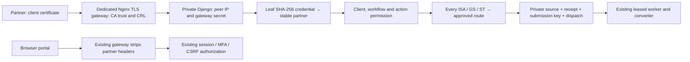

# Phase 4 partner identity and trusted gateway implementation

## Current route mode — 24 October 2026

`INTAKE_ENFORCE_PARTNER_ROUTES` now defaults to `false`. Add route, manual
entry, 835/837 envelope extraction and audited route storage remain available
for reference. Missing, retired or mismatched saved routes do not reject partner
uploads in this mode, including mTLS uploads. The admin UI reports "Details only
— under development" and hides the ineffective per-partner enforcement checkbox.
The readiness command reports this mode without requiring saved routes.

This disables only the saved-header allow-list check. HTTPS, certificate/token
authentication, explicit client authorization, workflow permissions, quotas,
idempotency and file validation still apply. Envelope structure/workflow checks
still run where they previously ran. Receipt route proofs are empty when matching
is disabled; saved records must not be interpreted as verified submission routes.
The caller's authorized `client_id` determines client assignment; headers are no
longer checked against that assignment. Multi-client integrations must supply the
correct client ID explicitly.

No migration or dependency change is required. Deploy both repositories and
restart API and worker services. Existing route records and per-partner routing
preferences are retained. A future deliberate server configuration change to
`INTAKE_ENFORCE_PARTNER_ROUTES=true` restores the tested enforcement path; review
all saved routes before doing so. The enforcement descriptions below apply only
when that switch is enabled.

Implemented 22 October 2026. Additive migration: `edi835.0066_partner_security`.
Production activation is a separate infrastructure change; it has not been performed.

Verification: the complete isolated regression suite ran 438 tests: 431 passed,
seven PostgreSQL-only checks skipped because no PostgreSQL test server is available
in this workspace. This includes 25 new partner-security tests and the legacy
upgrade migration test. Django migration-drift checking reported no changes.
See [machine-readable regression evidence](phase4-partner-security-regression.json).
The tests used Python 3.12, Django 5.2.18 and cryptography 50.0.2; the deployment's
existing cryptography pin also supports the certificate APIs used here.

## Architecture and boundaries



One partner remains bound to one client. Multiple exact envelope routes can be
approved for that client. Unknown routes, wrong versions, mixed workflows and
mixed-client files are rejected, without splitting or guessing from filenames,
claim numbers or certificate CNs. Multi-client identities are deliberately not
introduced in this release. Existing staff, Analysis and SFTP processing behavior
is unchanged; machine permissions currently support the PARTNER channel only.

| Requirement | Delivered | Remaining production evidence |
| --- | --- | --- |
| Stable partner identity | IntakePartner owns client/workflows/state; credentials rotate independently | Approved partner owners and scopes |
| Credentials and overlap | SHA-256 token secrets / DER certificate fingerprints, validity window, retirement, security revocation, replacement links | CA issuance, custody and renewal process |
| Explicit permissions | SUBMIT, READ, DOWNLOAD per workflow and PARTNER channel; no machine retry/admin access | Approved least-privilege grants |
| mTLS | Dedicated Nginx configuration; application validates actual proxy peer, gateway secret, verified status and pinned valid client-auth certificate | Live chain, CRL, private backend and spoofing tests |
| Routing | Every interchange/group/transaction checked using bounded memory, exact qualified identifiers and version rules; proof on receipt | Partner-supplied identifier/version approvals |
| Safe rotation/recovery | Stable partner-scoped submission keys survive rotation; same receipt returned | End-to-end lost-response test through deployed gateway |
| Administration | Audited operator commands; route replacement; no private keys stored | Restrict shell/SSM access, retain operator access logs |

New partner identities start with no permissions. Existing partners migrate to
equivalent permissions and token credentials with their original UUID, digest and
expiry; existing tokens continue working. Legacy `token_digest` and `expires_at`
remain for migration compatibility, but new-request authentication exclusively
uses PartnerCredential. There is no fallback to those deprecated fields.

READ is required to see a receipt; downloading additionally requires DOWNLOAD.
Partners see only receipts belonging to their own identity, not all client data.
Changing clients means creating a new identity, not moving ownership of old receipts.
Envelope routes are append/retire records, not editable definitions. Authorization
snapshots retain credential identity, fingerprint and approved route IDs/timestamps.

New accepted jobs survive natural credential expiry and planned retirement. A
security revocation, partner suspension or SUBMIT permission removal blocks queued
work at processing/retry authorization. This cannot undo already-running effects.
Route retirement stops new acceptance; an already accepted job keeps its approved
route proof. Suspend the partner when accepted work must also stop. Legacy receipts
without credential proof retain their previous expiry boundary.

## AWS rollout, in order

1. Confirm the actual TLS topology. The supplied template assumes Nginx directly
   receives partner TLS and talks to Gunicorn on `127.0.0.1:8000`. Do not install it
   unchanged behind an ALB that terminates the client TLS connection. An ALB mTLS
   deployment needs a separately reviewed identity adapter; arbitrary ALB headers
   are not accepted by this implementation.
2. Back up PostgreSQL and private source/output storage. Pause partner requests
   and partner provisioning during migration/restart. Drain active intake
   processing before restarting the worker. Plan the additive migration in a
   maintenance window. Do not drop old fields or reverse the migration on rollback.
3. Deploy the code with mTLS disabled (the default). Run migrations and Django
   checks using the same environment configuration as `mir.service`. Apply code
   and migration together; the new ORM fields require the migration.

```bash
cd /var/www/835_to_MIR_backend
source venv/bin/activate
git pull --ff-only origin main && \
python manage.py migrate --noinput && \
python manage.py check && \
sudo systemctl restart mir.service mir-batch-worker.service && \
sudo systemctl --no-pager --full status mir.service mir-batch-worker.service
```

Do not run tests against production. The shell must have the same application
environment as the service. This release uses the existing cryptography dependency
and its `not_valid_before_utc` / `not_valid_after_utc` APIs (cryptography 42+).
Verify `python -c 'import cryptography; print(cryptography.__version__)'`; the
repository dependency pin is 46.0.5. Upgrade through the tested deployment process
if production is older, before enabling certificate credentials.

4. Provision a separate partner DNS hostname and server certificate. Add it to
   Django ALLOWED_HOSTS. Keep the browser hostname/session configuration unchanged.
   Install the reviewed CA trust bundle and current CRLs for every issuing CA.
   Use `deploy/partner-mtls-nginx.conf.example`; adjust paths, chain depth, limits,
   upstream port and hostname. Do not use optional verification or automatic trust.
5. Restrict Gunicorn to loopback TCP for this topology. Inspect `systemctl cat
   mir.service` and `sudo ss -ltnp` before changing its bind; preserve its existing
   worker/timeouts/environment settings. Remove public EC2 security-group access
   to Gunicorn/database ports. An external host must not reach the backend directly.
   If a separate proxy/LB is used, restrict target ingress to its security group and
   review the adapter before activation. Never trust X-Forwarded-For as peer proof.
6. Include `deploy/strip-partner-headers-nginx.conf.example` inside **every public
   proxy location**. Nginx proxy-header inheritance changes when a child sets any
   proxy header. Also overwrite forwarded host/protocol according to the verified
   topology. Do not pass through client-provided identity headers on any listener.
7. Generate a strong random gateway secret using the deployment secret manager.
   Put the identical secret in the Django service environment and a root-owned
   mode-0600 Nginx include `/etc/nginx/secrets/filex-partner-gateway.conf` containing
   `proxy_set_header X-FileX-Gateway "<secret>";`. Never commit it, print it in logs,
   or share `nginx -T` output: expanded configuration includes the secret. Protect
   server keys, CRLs and trust configuration; partner private keys remain with partners.
8. Configure these environment values in the existing service environment source:

```text
INTAKE_PARTNER_ENABLED=true
INTAKE_MTLS_ENABLED=true
INTAKE_MTLS_TRUSTED_PEERS=127.0.0.1
INTAKE_MTLS_GATEWAY_SECRET=<managed random secret, at least 32 characters>
```

The trusted peer must be the actual socket peer, not a forwarded client IP. The
application has no public-peer default. The gateway overwrites the three internal
headers, strips cookies/bearer authentication, and only exposes `/api/v1/transfers`.
Ensure Gunicorn's request-header size limit accommodates the escaped leaf
certificate; the application caps it at 24 KiB (decoded certificate at 16 KiB).
Use a reviewed limit such as 32768 bytes; do not disable all header limits.

9. Provision a synthetic partner using the commands below. Disable real outbound
   delivery for its staging client. Run `python manage.py check_partner_security
   --require-mtls`. This checks application configuration only, not networking/PKI.
10. Validate and reload the gateway, restart **both** existing services after env
    changes, then execute the acceptance matrix. If Nginx validation fails, do not
    reload it. If an environment or bind change is made, verify the browser portal too.

```bash
sudo nginx -t && \
sudo systemctl reload nginx && \
sudo systemctl restart mir.service mir-batch-worker.service && \
sudo systemctl --no-pager --full status mir.service mir-batch-worker.service
```

## Partner onboarding and administration

Use the restricted operator shell (prefer audited AWS SSM sessions). Commands
record the shell account, reason, partner and changed IDs in the append-only audit
log. Shared OS accounts require SSM/session audit attribution to the human operator.
The browser Access screen has not been expanded into a PKI administration console.

```bash
python manage.py partner_security create --client-code STAGING --name "Pilot partner" \
  --workflow 837 --mode MTLS --reason "Approved synthetic pilot"
# Retain the returned stable partner_id as PARTNER_UUID.
python manage.py partner_security certificate --partner PARTNER_UUID \
  --certificate /secure/public-partner-leaf.pem --reason "Approved pilot credential"
python manage.py partner_security permissions --partner PARTNER_UUID \
  --config examples/partner-permissions.json --reason "Approved 837 submit/read/download"
python manage.py partner_security route --partner PARTNER_UUID \
  --config examples/partner-route-837.json --reason "Approved synthetic envelope mapping"
python manage.py partner_security status --partner PARTNER_UUID
```

The example route is synthetic. Replace it with independently approved partner
values before using real files. A route requires ISA05/06/07/08/12, GS02/03/08 and
ST03 (explicit empty string when absent) plus workflow. Each transaction must match
one active route. Retire a wrong route then add its replacement; do not edit records
directly. `retire-route --config` takes `{"route_id":123}`. No client routing is
derived from a filename or a certificate's subject name.

`permissions` replaces the complete permission set atomically. Removing SUBMIT
also blocks accepted jobs from starting. Token-mode partners use `token --config`
with `{"days":30}`; the secret is printed once. The legacy `intake_partner` command
is retained for compatibility, with equivalent broad workflow permissions and
optional routing; use `partner_security` for new least-privilege integrations.

## Rotation and revocation

Register the replacement certificate before switching the partner. Supply optional
`--config` JSON `{"replaces":"OLD_CREDENTIAL_UUID","reference":"Rotation ticket"}`.
Both credentials remain active during the overlap, bounded by their real validity
windows. Confirm the replacement can recover an existing submission and download
an authorized output. Then run `retire --config` with
`{"credential_id":"OLD_CREDENTIAL_UUID"}` and an audit reason. Retirement prevents
new authentication without discarding accepted jobs. Token rotation follows the
same stable-identity/overlap procedure. No raw secret is stored in audit details.

For compromise, use `revoke` with that credential JSON and a reason, and update the
CA CRL, validate Nginx and reload. App revocation applies to subsequent requests,
including an already established TLS connection. CA revocation also needs current
CRLs at the gateway. Suspended identities cannot authenticate with any credential.
Expired/revoked credentials cannot be reactivated by these commands; issue a new one.
Do not use token mode as an emergency fallback for an mTLS-required identity.

Assign an operations owner for CA/CRL publication and expiry alerts. Run
`check_partner_security --require-mtls` in your existing monitoring job; it warns
when an active partner has no certificate extending beyond 14 days. Monitor its
exit status, gateway rejection rates, disk capacity and the existing intake queue.
CRL freshness and server-certificate expiry require gateway/PKI monitoring too.

## Partner requests, polling and failure handling

The Python example accepts FILEX_CLIENT_CERT and FILEX_CLIENT_KEY; unset
FILEX_PARTNER_TOKEN for mTLS. FILEX_CA_BUNDLE optionally configures server trust.
It never disables hostname verification and never sends internal identity headers.
Keep private keys outside the repository with restrictive permissions.

Persist an Idempotency-Key before POST. A 202 acknowledges durable acceptance,
not successful conversion. Poll status after about 2 seconds, increasing to at most
30 seconds with jitter. Stop at COMPLETED, DUPLICATE, REJECTED or FAILED. A socket
timeout is uncertainty, not rejection: recover using the same key, then repeat the
same bytes/workflow/key only if needed. The sample's socket timeout is 60 seconds;
the gateway template allows a longer upstream operation. Do not poll indefinitely
without surfacing a delayed-job notification to the partner operator.

| Response | Meaning and action |
| --- | --- |
| 200 | Read or original receipt recovered; do not create another conversion |
| 202 | Durably accepted; poll the returned status URL |
| TLS refusal / gateway 400 or 495/496 internally | Missing, expired, untrusted or revoked certificate; correct credentials/PKI; may not return JSON |
| 400 INVALID_REQUEST | Multipart/key/envelope/approved-route problem; correct it before submitting |
| 401 AUTHENTICATION_REQUIRED | Invalid machine credential or trusted-gateway proof; no session fallback |
| 403 FORBIDDEN | Missing permission or inactive client; obtain approval, do not loop retry |
| 404 NOT_FOUND | Receipt outside scope or recovery not yet committed; a recovery 404 alone does not prove upload failure |
| 405 METHOD_NOT_ALLOWED | Use the documented method |
| 409 IDEMPOTENCY_CONFLICT | Same key with changed bytes/client/workflow; investigate before assigning a new key |
| 409 SUBMISSION_IN_PROGRESS | Retry unchanged after Retry-After; another request may be committing |
| 409 RETRY_NOT_ELIGIBLE | Operator retry would be unsafe; reconcile effects/state |
| 413 UPLOAD_TOO_LARGE / gateway 413 | File/request exceeds limits; gateway response may not be JSON |
| 415 UNSUPPORTED_MEDIA_TYPE | Use multipart/form-data for uploads |
| 429 | Gateway rate limit; bounded backoff with jitter, retain original key |
| 503 INTAKE_UNAVAILABLE / gateway 502/504 | Acceptance uncertain; recover before retrying |
| 503 FILE_UNAVAILABLE | Source/output unavailable or integrity check failed; operator investigation |
| 503 RETRY_UNAVAILABLE | Retry commit uncertain; check receipt status first |
| REJECTED / FAILED receipt | Asynchronous validation rejection / processing failure after acceptance; use safe error code; no blind replay |

Duplicate bytes within client/workflow create a linked DUPLICATE receipt when
submitted with a new key. Claim corrections/reversals are not filtered by claim ID
here. Same principal/key/bytes/routing recovers the original receipt even after
credential rotation. New partner identities have independent key namespaces.

## Required staging acceptance

| Test | Expected |
| --- | --- |
| Approved valid certificate and route, then existing converter | 202; receipt/attempt/output provenance, correct existing MIR behavior |
| Missing cert, wrong CA, expired cert, revoked CRL entry | Gateway refuses; no new receipt |
| Unknown leaf issued by trusted CA | Application 401; no new receipt |
| Forged FileX headers on browser hostname, even with valid staff cookie | Cannot authenticate a partner; browser session remains subject to existing CSRF/role checks |
| Internet connection to Gunicorn port | Unreachable; no direct bypass |
| Unknown client/version, mixed-client or mixed-workflow interchange | Rejected before receipt/dispatch commit |
| Two certificates during overlap | Both authorized for same partner; recovered receipt ID identical |
| Retired or security-revoked old credential | Subsequent requests denied; queued-work policy behaves as documented |
| Lost upload response and concurrent same key | Original receipt recovered; one logical conversion; PostgreSQL race tests pass |
| Client/partner cross-scope list/detail/download/retry | No disclosure; partner retry denied |
| Browser sign-in/Analysis/upload on original hostname | No certificate prompt; existing flows still work |

Local application tests use synthetic certificates and gateway headers. They
cannot establish that Nginx actually validates chains or CRLs, nor that AWS ports
are private. Run the PostgreSQL test suite on an isolated staging database; SQLite
cannot prove production row/advisory-lock behavior. Retain test evidence before
enabling a real partner. Gateway templates have not been run against live AWS.

## Rollback and scope

Pause partner traffic at the dedicated gateway first. Preserve accepted receipts,
private objects, keys and all new tables. For a planned rollback, drain existing
work with the current worker; for a security incident suspend affected partners
and reconcile any effects already started. Do not return mTLS identities to token
mode. Turning INTAKE_MTLS_ENABLED off rejects mTLS requests; it does not itself
cancel accepted work. Prefer a forward fix over reversing credentials/migrations.
Keep the worker code compatible with the accepted receipt schema until drained.

This release does not implement multi-client partner identities, certificate
issuance, automatic CRL distribution, a browser PKI console, Phase 5 retention/legal
holds/scanning, or Phase 6 pilot approval. No AWS configuration was changed.

References: [Nginx TLS verification, CRLs and escaped certificate forwarding](https://nginx.org/en/docs/http/ngx_http_ssl_module.html),
[AWS target security-group restrictions](https://docs.aws.amazon.com/elasticloadbalancing/latest/application/load-balancer-update-security-groups.html),
[OpenAPI 3.1 mutualTLS scheme](https://spec.openapis.org/oas/v3.1.0.html#security-scheme-object).
